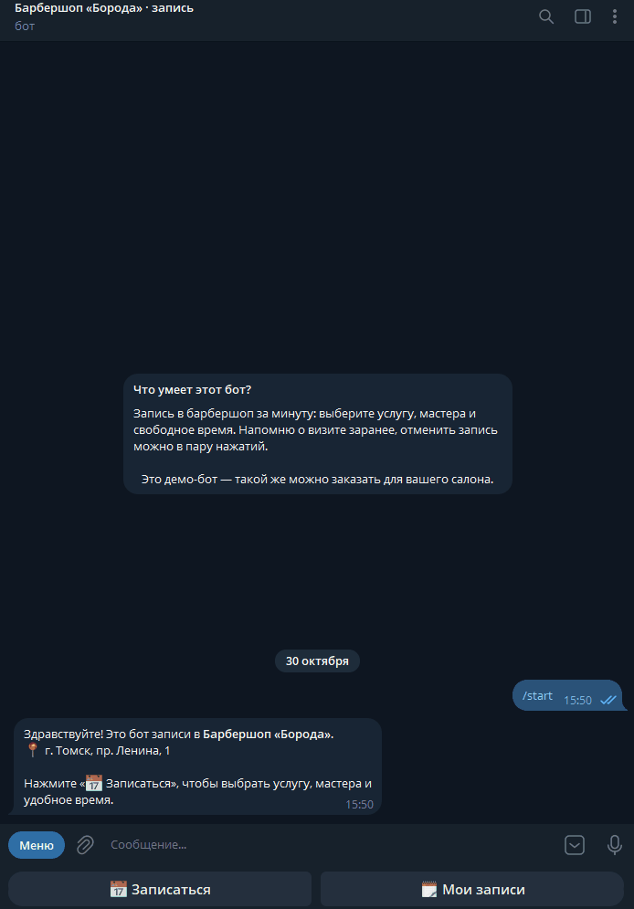
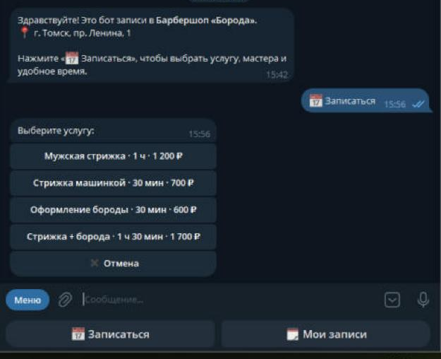
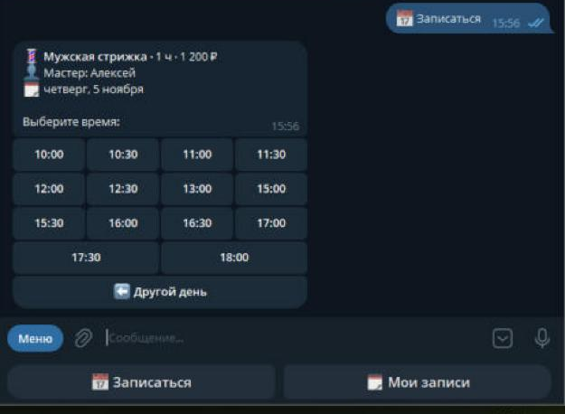
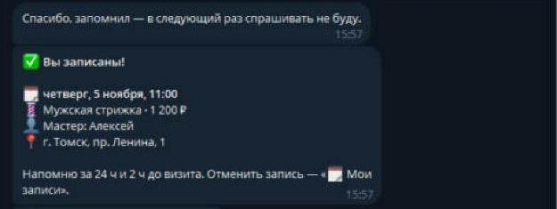
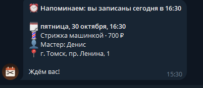
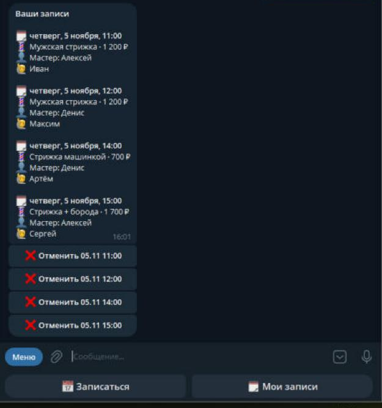
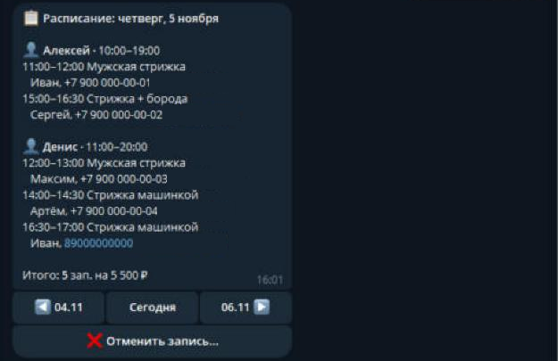
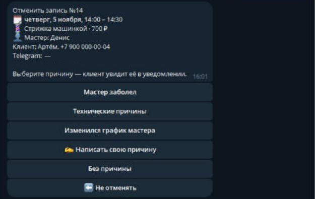

# Booking Bot — Telegram-бот записи клиентов

[](https://github.com/SHUHER322/booking_bot/actions/workflows/tests.yml)

Онлайн-запись в барбершоп, салон красоты, к репетитору или любому мастеру — прямо в Telegram.
Клиент за минуту выбирает услугу, мастера и свободное время, получает напоминания о визите
и может сам отменить запись. Админ мгновенно узнаёт о каждой записи и видит расписание на день.

Услуги, мастера, графики и перерывы задаются в одном понятном файле `salon.toml` —
под нового заказчика код менять не нужно.

**Стек:** Python 3.12–3.14, aiogram 3, SQLite, Docker, pytest + GitHub Actions.

## Как это выглядит

<p align="center">
  
</p>

<table>
  <tr>
    <th>Выбор услуги</th>
    <th>Свободное время</th>
    <th>Запись подтверждена</th>
    <th>Напоминание</th>
  </tr>
  <tr>
    <td></td>
    <td></td>
    <td></td>
    <td></td>
  </tr>
  <tr>
    <th>Мои записи</th>
    <th>Уведомление админу</th>
    <th>Расписание на день</th>
    <th>Отмена с причиной</th>
  </tr>
  <tr>
    <td></td>
    <td></td>
    <td></td>
    <td></td>
  </tr>
</table>

## Возможности

**Для клиента**
- Запись кнопками в одном сообщении: услуга (длительность и цена) → мастер или «любой свободный» → день → время → подтверждение
- Показываются только дни и время, где действительно есть место: учитываются график мастера, перерывы, длительность услуги и другие записи
- Имя и телефон спрашиваются один раз и запоминаются; можно записать другого человека, не меняя свои контакты
- «Мои записи» — список предстоящих визитов и отмена в пару нажатий (не позже чем за N часов, дальше — телефон салона)
- Напоминания за 24 ч и за 2 ч (настраивается) с кнопкой отмены

**Для админа**
- Уведомление о каждой новой записи и отмене (можно несколько админов)
- `/today`, `/tomorrow` — расписание по мастерам с итогом за день, листание дней кнопками
- Отмена записи с причиной (готовые кнопки или свой текст) — клиент сразу получает уведомление

**Надёжность**
- Двойная запись невозможна: два клиента, нажавшие на одно время одновременно, не попадут на него оба — второй увидит «время только что заняли»
- Напоминания хранят отметки в базе: после перезапуска бот не напомнит дважды и никого не пропустит
- Всё время считается по часовому поясу салона, где бы ни был запущен бот
- Ошибки в `salon.toml` объясняются по-русски: «Мастер «Анна»: нет таких услуг: Маникюр»
- 70+ тестов на pytest с автозапуском в GitHub Actions

## Настройка салона — `salon.toml`

```toml
[salon]
name = "Барбершоп «Борода»"
address = "г. Томск, пр. Ленина, 1"
phone = "+7 3822 00-00-00"
slot_step = 30            # шаг сетки времени, минуты
days_ahead = 14           # на сколько дней вперёд можно записаться
min_hours_before = 1      # не раньше чем за … ч до начала
cancel_hours_before = 3   # клиент может отменить сам не позже чем за … ч
reminders = [24, 2]       # за сколько часов напоминать

[[services]]
name = "Мужская стрижка"
minutes = 60
price = 1200

[[masters]]
name = "Алексей"
services = ["Мужская стрижка", "Оформление бороды"]
days = ["пн", "вт", "ср", "чт", "пт"]
hours = "10:00-19:00"
breaks = ["14:00-15:00"]
```

После правки файла перезапустите бота. Старые записи не ломаются: услуга и мастер
хранятся в записи по названию.

## Запуск

```bash
python -m venv .venv             # на Windows с несколькими Python: py -V:3.14 -m venv .venv
source .venv/bin/activate        # Windows: .venv\Scripts\activate
pip install -r requirements.txt
cp .env.example .env             # Windows: copy .env.example .env
# заполнить BOT_TOKEN и ADMIN_CHAT_ID в .env, услуги и мастеров — в salon.toml
python -m bot.main
```

Настройки в `.env`:

```
BOT_TOKEN=123456:ABC-your-token      # от @BotFather
ADMIN_CHAT_ID=123456789,987654321    # кому слать уведомления (один или несколько)
TIMEZONE=Asia/Tomsk                  # часовой пояс салона
SALON_CONFIG=salon.toml
DB_PATH=bookings.db
```

На Windows можно запускать двойным кликом по `run.bat` или по F5 в VS Code.

Тесты: `pip install -r requirements-dev.txt && pytest`

## Запуск в Docker (сервер)

```bash
cp .env.example .env          # заполнить токен и ID админа
mkdir -p data                 # здесь будет лежать база
docker compose up -d --build  # собрать и запустить в фоне
```

```bash
docker compose logs -f        # логи (выход: Ctrl + C)
docker compose restart        # перезапустить — например, после правки salon.toml
git pull && docker compose up -d --build   # обновить код
```

База лежит в `data/bookings.db` и переживает пересборку. `salon.toml` подключён снаружи
контейнера: чтобы поменять услуги или график, достаточно отредактировать файл и сделать
`docker compose restart`. Бот сам поднимается после падения и перезагрузки сервера.

## Структура

```
salon.toml        — услуги, мастера, графики (правит заказчик)
bot/
  salon.py        — разбор salon.toml с понятными ошибками
  config.py       — настройки из .env
  slots.py        — расчёт свободного времени (чистые функции)
  availability.py — свободные дни и время с учётом записей
  db.py           — клиенты и записи, защита от двойной записи
  handlers.py     — запись клиента
  my_bookings.py  — «Мои записи» и отмена
  admin.py        — расписание и отмена записи админом
  reminders.py    — напоминания
  texts.py, schedule.py, keyboards.py, notify.py, states.py, main.py
tests/            — pytest
```

## Что можно добавить под заказчика

Онлайн-оплата или предоплата (ЮKassa), выходные и отпуска мастеров, управление услугами
и графиком прямо из бота, выгрузка записей в Google Таблицу, отзывы после визита.
